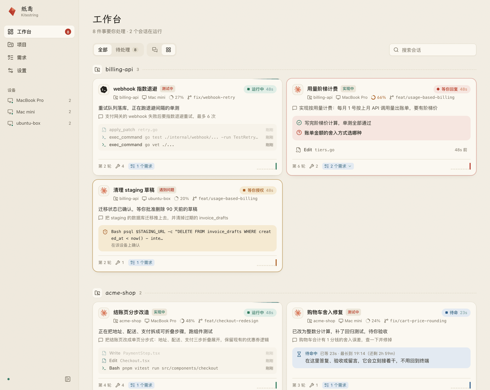
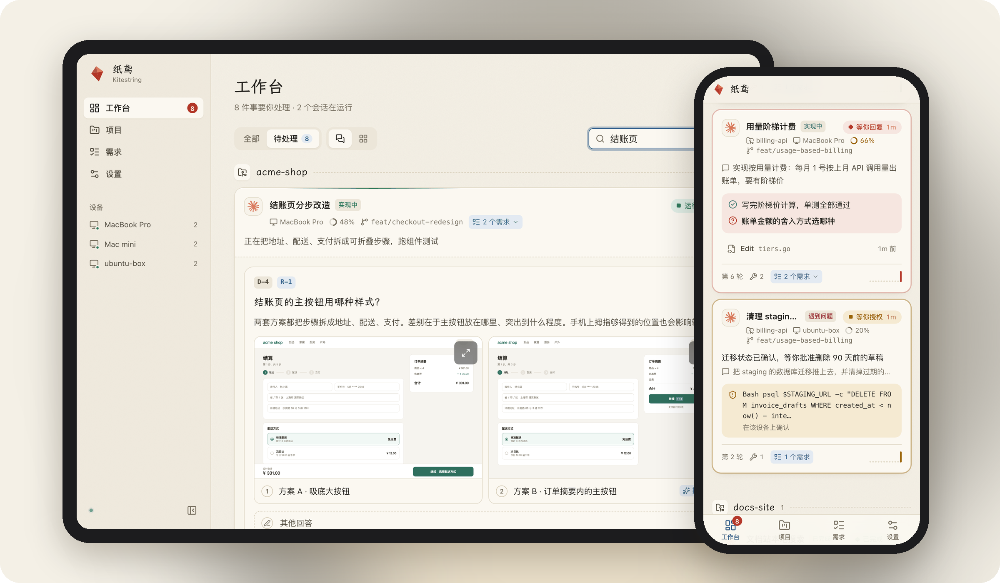
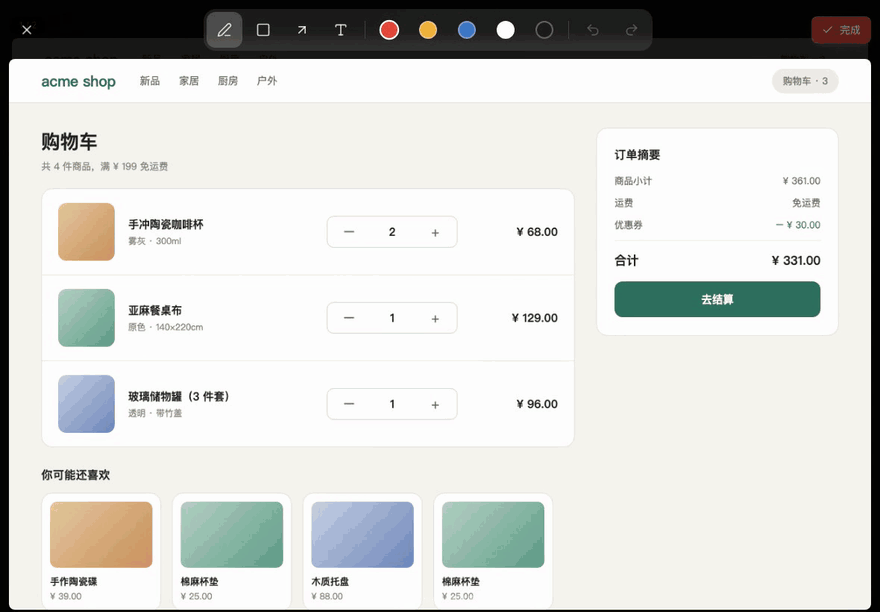
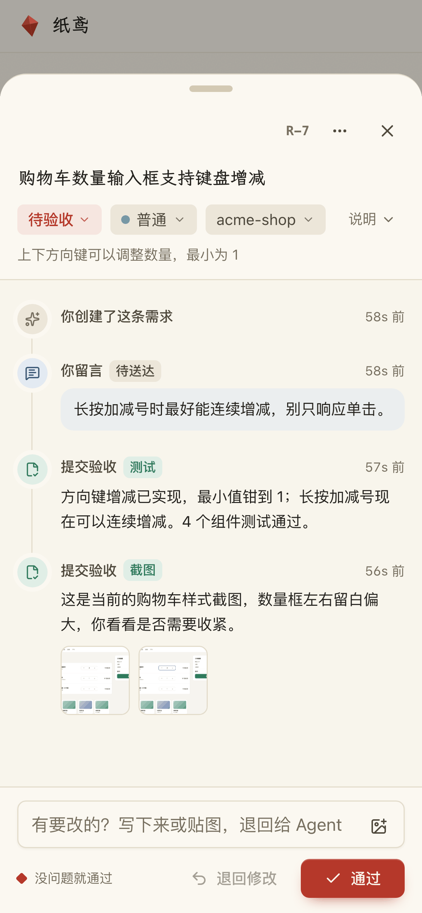
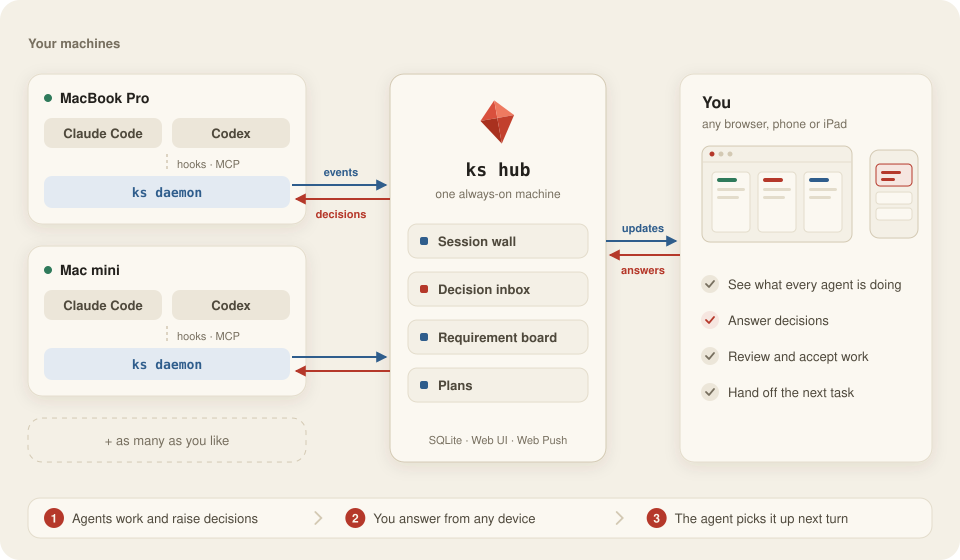

<p align="center">
  
</p>

<h1 align="center">Kitestring</h1>

<p align="center">
  <strong>One board for every Claude Code and Codex session on every machine you own.</strong><br>
  See what each agent is doing, answer what it's waiting on, and hand it the next task — from your desk or your phone.
</p>

<p align="center">
  <a href="docs/install.md">Install</a> ·
  <a href="docs/how-it-works.md">How it works</a> ·
  <a href="README.zh-CN.md">中文</a>
</p>

<p align="center">
  <a href="https://github.com/NekroAI/kitestring/actions/workflows/ci.yml"></a>
  <a href="https://github.com/NekroAI/kitestring/releases/latest"></a>
  
  <a href="LICENSE"></a>
</p>

<picture>
  <source media="(prefers-color-scheme: dark)" srcset="docs/assets/screenshot-sessions-dark.png">
  
</picture>

## What it does

- **See every session at a glance.** Sessions on all your machines, grouped by project — running, waiting on you, standing by or done, with what each one is doing right now.
- **Answer from anywhere.** When an agent needs a decision, you get a push notification. Pick an option on your phone, and the answer lands in that agent's next turn.
- **Keep the work in one place.** Agents record requirements as they go; you confirm them, hand them to a session, and accept the results with screenshots attached.

## Made for your phone and iPad

<picture>
  <source media="(prefers-color-scheme: dark)" srcset="docs/assets/showcase-dark.png">
  
</picture>

Step away from the desk and keep things moving from the couch, the train or bed.

- **Installs like an app.** Add it to your home screen and it runs full screen. Sign in with a passkey (Face ID / Touch ID).
- **Tells you when it's your turn.** Push notifications on iPhone, iPad and desktop browsers (also Bark and WeCom); tap one to land on that exact session or requirement.
- **Built for touch.** Long-press a card and drag it to another column, swipe through screenshots, swipe between requirements while reviewing — and nothing zooms or bounces when it shouldn't.

### Mark it up with Apple Pencil

<p align="center"></p>

Circle, box, point and write right on the agent's screenshots. The pen follows pressure, your palm is ignored once you've used a pencil, and the marked-up image goes back to the agent with your feedback. Works with a finger, mouse or trackpad too.

### Review on the go

<table>
  <tr>
    <td width="300"><picture><source media="(prefers-color-scheme: dark)" srcset="docs/assets/phone-review-dark.png"></picture></td>
    <td>
      <ul>
        <li><b>Evidence, not claims.</b> Agents attach test results, screenshots and screen recordings — a screenshot claim without the image is rejected.</li>
        <li><b>Accept or send back in one tap.</b> Write a note or paste a picture to send it back; accept and the next requirement slides in.</li>
        <li><b>Pick a design by looking at it.</b> Agents propose 2–3 options with mockups; you tap the one you want.</li>
        <li><b>Approve plans with a note.</b> Yes or no, both can carry a comment and images.</li>
      </ul>
    </td>
  </tr>
</table>

## More highlights

- **Hand off the next task.** Give a requirement to a session; to-dos queue up and arrive together when it goes idle. A session waiting in `ks wait` picks it up within seconds.
- **Plans with gates.** Split a big goal into stages; each stage unlocks only after you accept the previous one.
- **A live view of every session.** Recent tool calls stream in, a ring shows how full the context is, and — if you connect your own model — a one-line summary says what it's doing.
- **One project across machines.** Sessions are grouped by git remote, so the same repo on your laptop and your Mac mini is one project.
- **Never in the way.** Hooks time out in 1.5 s and fail open; offline machines buffer events and catch up later.

## How it works

<picture>
  <source media="(prefers-color-scheme: dark)" srcset="docs/assets/architecture-dark.svg">
  
</picture>

A small daemon on each machine listens to your agents through their official hooks and MCP, and reports to a Hub on one always-on machine. You use the Hub's web board from any browser. Details: [How it works](docs/how-it-works.md).

## Get started

**1. Install `ks`** on every machine — the Hub and each machine you code on (macOS or Linux):

```bash
curl -fsSL https://raw.githubusercontent.com/NekroAI/kitestring/main/scripts/install.sh | sh
```

**2. Start the Hub** on one always-on machine, then open `http://<hub>:7310`:

```bash
ks hub passwd && ks install --hub --claude=false --codex=false --daemon=false
```

**3. Connect each machine** with a token from **Settings → Devices**:

```bash
ks login --hub http://<hub>:7310 --token kst_xxx && ks install
```

Open Claude Code or Codex and your session appears on the board. Updating, Codex setup and building from source: [Install guide](docs/install.md).

## Safe for your subscription

Kitestring only uses the extension points Claude Code and Codex document officially. It never touches your login credentials, never proxies model traffic, never consumes your subscription and never drives agents on its own. [Read more](docs/how-it-works.md#account-safety).

## Contributing

Issues and pull requests are welcome — see [CONTRIBUTING.md](CONTRIBUTING.md). Report security problems privately as described in [SECURITY.md](SECURITY.md).

## License

[AGPL-3.0-or-later](LICENSE)
