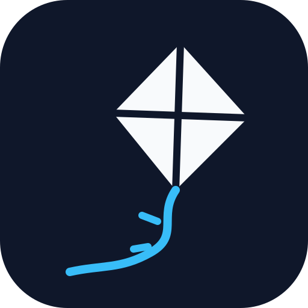
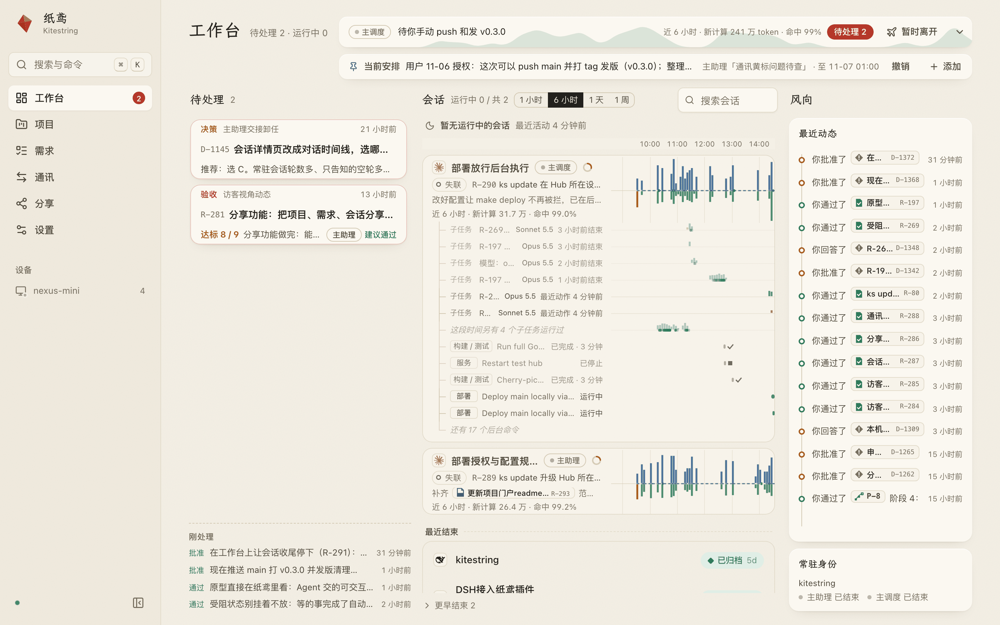
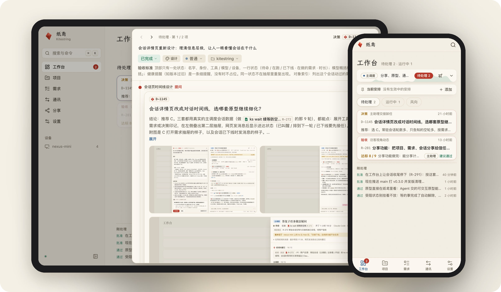
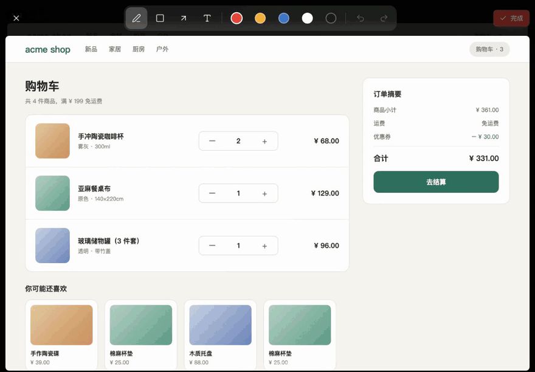
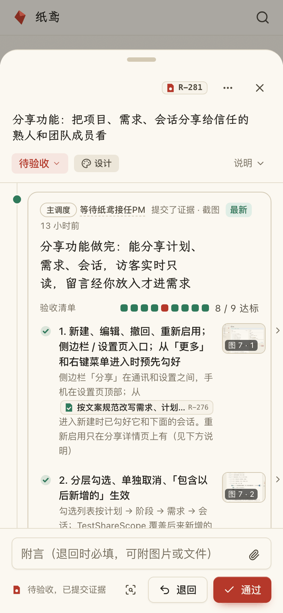
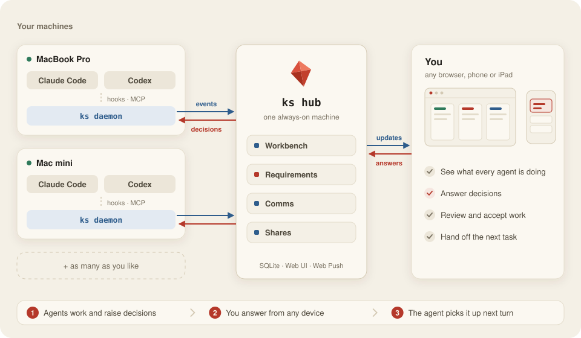

<p align="center">
  
</p>

<h1 align="center">Kitestring</h1>

<p align="center">
  <strong>One board for every Claude Code and Codex session on every machine you own.</strong><br>
  See what each agent is doing, answer what it's waiting on, and hand it the next task — from your desk or your phone.
</p>

<p align="center">
  <a href="docs/install.md">Install</a> ·
  <a href="docs/how-it-works.md">How it works</a> ·
  <a href="README.zh-CN.md">中文</a>
</p>

<p align="center">
  <a href="https://github.com/NekroAI/kitestring/actions/workflows/ci.yml"></a>
  <a href="https://github.com/NekroAI/kitestring/releases/latest"></a>
  
  <a href="LICENSE"></a>
</p>

<picture>
  <source media="(prefers-color-scheme: dark)" srcset="docs/assets/screenshot-sessions-dark.png">
  
</picture>

## What it does

- **See every session at a glance.** The workbench lists what needs you, gives every session on every machine a lane, and streams what each one is doing right now — running, waiting on you, standing by or done.
- **Answer from anywhere.** When an agent needs a decision, you get a push notification. Pick an option on your phone, and the answer lands in that agent's next turn.
- **Keep the work in one place.** Agents record requirements as they go; you confirm them, hand them to a session, and accept the results with screenshots attached.

## Made for your phone and iPad

<picture>
  <source media="(prefers-color-scheme: dark)" srcset="docs/assets/showcase-dark.png">
  
</picture>

Step away from the desk and keep things moving from the couch, the train or bed.

- **Installs like an app.** Add it to your home screen and it runs full screen. Sign in with a passkey (Face ID / Touch ID).
- **Tells you when it's your turn.** Push notifications on iPhone, iPad and desktop browsers (also Bark and WeCom); tap one to land on that exact session or requirement.
- **Built for touch.** Long-press a card and drag it to another column, swipe through screenshots, swipe between requirements while reviewing — and nothing zooms or bounces when it shouldn't.

### Mark it up with Apple Pencil

<p align="center"></p>

Circle, box, point and write right on the agent's screenshots. The pen follows pressure, your palm is ignored once you've used a pencil, and the marked-up image goes back to the agent with your feedback. Works with a finger, mouse or trackpad too.

### Review on the go

<table>
  <tr>
    <td width="300"><picture><source media="(prefers-color-scheme: dark)" srcset="docs/assets/phone-review-dark.png"></picture></td>
    <td>
      <ul>
        <li><b>Evidence, not claims.</b> Agents attach test results, screenshots and screen recordings — a screenshot claim without the image is rejected.</li>
        <li><b>Accept or send back in one tap.</b> Write a note or paste a picture to send it back; accept and the next requirement slides in.</li>
        <li><b>Pick a design by looking at it.</b> Agents propose 2–3 options with mockups; you tap the one you want.</li>
        <li><b>Approve plans with a note.</b> Yes or no, both can carry a comment and images.</li>
      </ul>
    </td>
  </tr>
</table>

## More highlights

- **A team of roles, not one chat.** Tell a session who it is — manager (PM), aide, advisor, reviewer, developer (`ks role`) — and each knows its job: the PM schedules and merges, the aide judges and answers for you within the limits you set, the reviewer checks work before it reaches you, developers implement. Sub-tasks run in the background and show up in the lanes.
- **Sessions talk to each other.** Leave a comment under a requirement, message one session or broadcast to many, see who is online and whether a message was delivered — all on the read-only **Comms** page. "Act on this" messages wake a session; "FYI" ones don't.
- **Share with people you trust.** Pick plans, requirements and sessions, and hand out a named visitor link with an optional password and expiry. Visitors get a live, read-only view; what they write is held in a queue until you put it into the requirement (as it is or reworded) — nothing reaches the agents without you.
- **Prototypes you can open right here.** An agent can attach an interactive prototype (an HTML page with its assets) to a requirement or to each option of a decision. It opens full screen in Kitestring, in a sandbox that cannot touch your login or the API, with width presets for phone, tablet and desktop. `ks proto check` self-checks a package before it is handed in.
- **Update with one command.** `ks update` pulls the latest release, verifies it, replaces `ks` and restarts the Hub and background services.
- **Hand off the next task.** Give a requirement to a session; to-dos queue up and arrive together when it goes idle. A session waiting in `ks wait` picks it up within seconds.
- **Blocked doesn't linger.** A requirement marked blocked is released automatically once the thing it waited on is done, and linking a session to it starts the work.
- **Plans with gates.** Split a big goal into stages; each stage unlocks only after you accept the previous one.
- **A live view of every session.** Recent tool calls stream in, a ring shows how full the context is, and — if you connect your own model — a one-line summary says what it's doing.
- **Swim-lane timeline.** Every session gets a lane on the workbench, summarised per minute; below the midline it draws newly computed tokens (coloured by cache hit rate, with cold starts marked), and each background shell command gets its own row with start, end, type and result — failures stand out, runaways turn yellow. "Orphan" processes that outlived their ended session are listed so you can stop or ignore them.
- **Context ring and compact hint.** A ring next to each session title shows how full the context is; near the threshold it turns yellow, then red with "compact suggested", and one click copies the `/compact` command for that role.
- **Session handoff.** Click "Hand off" on a session and the old one writes down what it is doing, what it waits on, the ground rules and the next step; run `ks takeover <role>` in the project directory to start the successor. Key state is also restored automatically after a compaction. Older MCP builds use `ks handoff`.
- **Review before you.** When a requirement is submitted for acceptance it is first sent to an online reviewer; it reaches your to-do list only after the review is in (or after 30 quiet minutes). Acceptance cards show the review status and verdict.
- **FYI messages don't wake anyone.** Team messages and subscribed events are either "act on this" or "FYI only"; FYI items don't wake a session and are attached the next time it is woken.
- **Sub-task model policy.** A per-project setting with three levels — economy, balanced, quality first — written into the PM, Aide and Dev prompts to steer which model sub-tasks use.
- **Status comes from explicit records.** What a session is waiting for, approve / reject and the recommended option are stored as fields; a question in the chat no longer counts as "waiting for you".
- **Multiple Claude config directories.** If you run Claude Code under several `CLAUDE_CONFIG_DIR`s, hook each up with `ks install --claude-dir`; session cards show where each one came from (see [Install](docs/install.md#multiple-claude-configs)).
- **Briefing strip and "Away".** A one-line strip on top of the workbench ("who wrote it · one-line conclusion · n to look at") rotates and opens a layered report. Switch on "Away" and the Aide answers within the scope you allow, pushes are limited to hard rules and uncertain calls, and you get a report when you return.
- **One undo window, kept drafts.** Every verdict shares the same undo window and takes effect immediately; every input box keeps its draft across closing a drawer, refreshing or switching items.
- **One project across machines.** Sessions are grouped by git remote, so the same repo on your laptop and your Mac mini is one project.
- **Never in the way.** Hooks time out in 1.5 s and fail open; offline machines buffer events and catch up later.

## How it works

<picture>
  <source media="(prefers-color-scheme: dark)" srcset="docs/assets/architecture-dark.svg">
  
</picture>

A small daemon on each machine listens to your agents through their official hooks and MCP, and reports to a Hub on one always-on machine. You use the Hub's web app from any browser. Details: [How it works](docs/how-it-works.md).

## Get started

**1. Install `ks`** on every machine — the Hub and each machine you code on (macOS or Linux):

```bash
curl -fsSL https://raw.githubusercontent.com/NekroAI/kitestring/main/scripts/install.sh | sh
```

**2. Start the Hub** on one always-on machine, then open `http://<hub>:7310`:

```bash
ks hub passwd && ks install --hub --claude=false --codex=false --daemon=false
```

**3. Connect each machine**: click **Add device** under **Settings → Devices**; the guide that opens has the full commands for your platform (PATH, background service, check). The core of it:

```bash
ks login --hub http://<hub>:7310 --token kst_xxx && ks install
```

When `ks status` shows `"connected": true`, open Claude Code or Codex and your session appears on the workbench. Step by step, Linux services, DSH and building from source: [Install guide](docs/install.md#3-every-development-machine).

**Updating.** Run `ks update` on each machine: it downloads the latest release, verifies it against `SHA256SUMS.txt`, replaces `ks` and restarts the Hub and daemon services that run it (`ks update --check` only looks). Versions 0.2.0 and earlier don't have it yet — re-run the install script once; see [Updating](docs/install.md#updating).

## Safe for your subscription

Kitestring only uses the extension points Claude Code and Codex document officially. It never touches your login credentials, never proxies model traffic, never consumes your subscription and never drives agents on its own. [Read more](docs/how-it-works.md#account-safety).

## Contributing

Issues and pull requests are welcome — see [CONTRIBUTING.md](CONTRIBUTING.md). Report security problems privately as described in [SECURITY.md](SECURITY.md).

## License

[AGPL-3.0-or-later](LICENSE)
