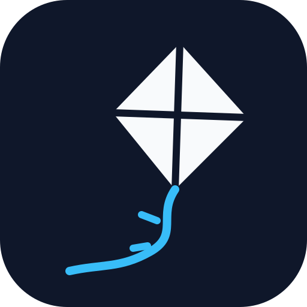
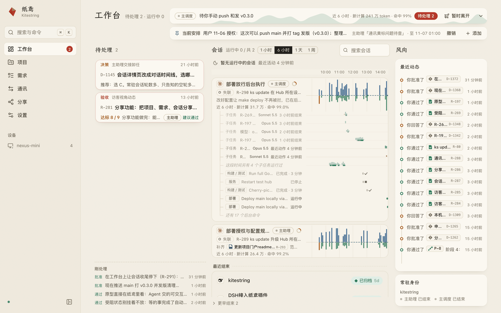
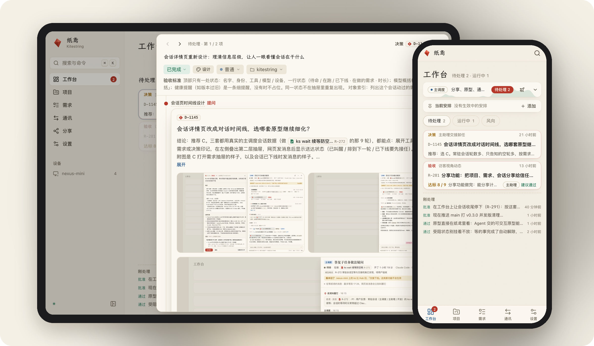
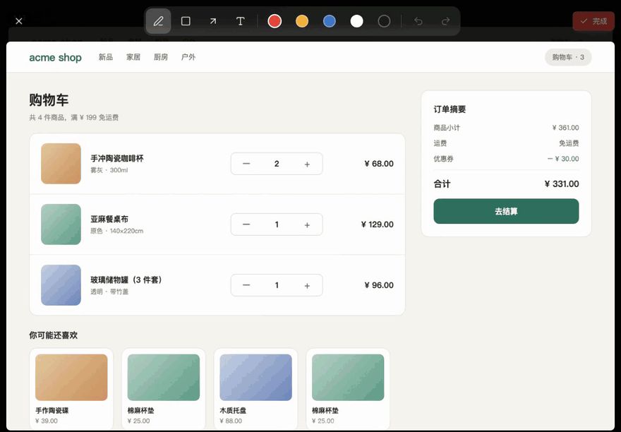
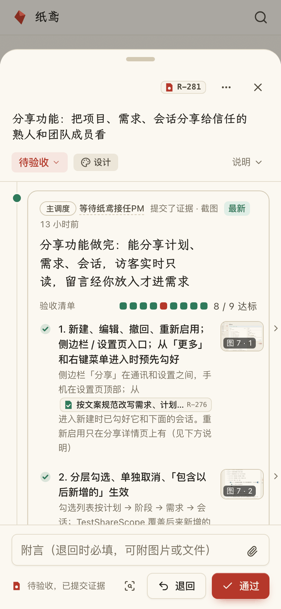
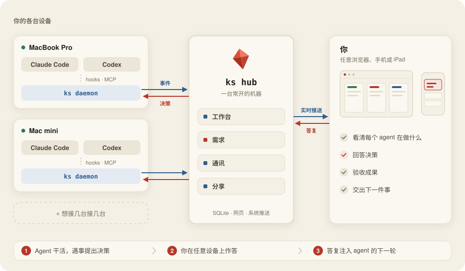

<p align="center">
  
</p>

<h1 align="center">纸鸢 · Kitestring</h1>

<p align="center">
  <strong>风筝飞得再远，线在你手里。</strong><br>
  一块看板管住你所有设备上的 Claude Code 与 Codex 会话：看清每个 agent 在做什么，回答它在等的事，交给它下一件事——在电脑前或手机上都行。
</p>

<p align="center">
  <a href="docs/install.zh-CN.md">安装</a> ·
  <a href="docs/how-it-works.zh-CN.md">工作原理</a> ·
  <a href="README.md">English</a>
</p>

<p align="center">
  <a href="https://github.com/NekroAI/kitestring/actions/workflows/ci.yml"></a>
  <a href="https://github.com/NekroAI/kitestring/releases/latest"></a>
  
  <a href="LICENSE"></a>
</p>

<picture>
  <source media="(prefers-color-scheme: dark)" srcset="docs/assets/screenshot-sessions-dark.png">
  
</picture>

## 它能做什么

- **一眼看清所有会话**：所有设备上的会话按项目归在一起——运行中、等你处理、待命中还是已完成，以及此刻在做什么。
- **在哪都能答复**：agent 需要你决策时，手机收到推送；点一个选项，答复就进入那个 agent 的下一轮。
- **事情都记在一处**：agent 边做边记下需求；你确认、交给会话、对着截图验收。

## 为手机和 iPad 而做

<picture>
  <source media="(prefers-color-scheme: dark)" srcset="docs/assets/showcase-dark.png">
  
</picture>

离开工位也不断线：沙发上、地铁上、躺在床上，照样推进进度。

- **像 App 一样用**：添加到主屏幕后全屏运行，可用 passkey（面容 / 触控 ID）登录。
- **轮到你时会提醒**：iPhone、iPad 和桌面浏览器都能收到系统推送（也支持 Bark、企业微信），点通知直达对应的会话或需求。
- **为触屏打磨**：长按卡片拖到别的列改状态、左右滑看截图、验收时滑动切换需求；该稳的地方不会乱缩放、乱回弹。

### 用 Apple Pencil 直接批注

<p align="center"></p>

在 agent 交来的截图上圈、框、画箭头、写字。笔画粗细跟随笔压，用过手写笔后自动忽略手掌；标注好的图会和你的意见一起送回 agent。手指、鼠标、触控板也都能用。

### 随手验收

<table>
  <tr>
    <td width="300"><picture><source media="(prefers-color-scheme: dark)" srcset="docs/assets/phone-review-dark.png"></picture></td>
    <td>
      <ul>
        <li><b>拿证据说话</b>：agent 交测试结果、截图、录屏；声称有截图却没附图的证据会被拒收。</li>
        <li><b>一下通过或退回</b>：写几句或贴张图就能退回；通过后自动滑到下一条。</li>
        <li><b>看图选方案</b>：agent 交两三套带效果图的方案，点一下选定。</li>
        <li><b>批准方案可附言</b>：批准或拒绝都能附上说明和图片。</li>
      </ul>
    </td>
  </tr>
</table>

## 更多亮点

- **交出下一件事**：把需求交给会话；待办会在它空闲时整批送达，挂着 `ks wait` 的会话几秒内就开工。
- **分阶段的计划**：大目标拆成阶段，上一阶段你验收通过后，下一阶段才解锁。
- **每个会话实时可见**：最近的工具调用实时滚动，小圆环显示上下文占用；接入你自己的模型后，还有一句话进展摘要。
- **泳道时间线**：工作台每个会话一条泳道，按分钟汇总工具调用；中线以下画新算的 token（颜色按缓存命中率，冷启动有标记），后台命令（shell）每条一行，画起止、类型和结果，失败醒目、跑飞标黄。会话已结束、后台进程还在跑的「孤儿进程」单独列出，确认后可停止，也可忽略。
- **上下文圆环与建议压缩**：会话标题旁常显上下文圆环，接近阈值变黄、变红并标「建议压缩」，一键复制按身份生成的 `/compact` 命令。
- **会话交接**：会话上点「交接」，旧会话写下在做的、等你的、约定、下一步；在项目目录运行 `ks takeover <身份>` 开新会话接任，压缩后也会自动补回关键状态。旧版 MCP 用 `ks handoff` 写交接。
- **评审验证**：需求交验收后自动派给在线评审先审，审完才进你的「要你处理」（30 分钟没动静照常弹给你）；验收卡标出评审状态与结论。
- **告知类消息不叫醒**：团队消息和订阅事件分「要动手 / 只告知」两档，只告知的不叫醒会话，下次一并附上。
- **子任务模型策略**：项目设置里「经济 / 均衡 / 质量优先」三档，写进主调度、主助理、开发的身份提示词，决定派子任务时怎么选模型。
- **状态只认明确记录**：等你的类型、批准 / 拒绝、推荐选项都存成字段，对话里的一句问话不再被算成「在等你」。
- **多个 Claude 配置目录**：用 `CLAUDE_CONFIG_DIR` 开多套 Claude Code 时，`ks install --claude-dir` 逐个接入，会话卡片标出来源（见[安装说明](docs/install.zh-CN.md#多个-claude-配置)）。
- **顶部简报条与「暂时离开」**：工作台顶部常驻一行简报「谁写的 · 一句话结论 · 待你查看 n」，可轮播、点开看分层报告；点「暂时离开」后，主助理在授权范围内代答，推送只留硬规则和拿不准的，回来先看离开期间的报告。
- **统一的撤销期与草稿缓存**：所有判断动作共用一套撤销期，结果立刻到位；所有输入框的草稿统一缓存，关抽屉、刷新、换设备前都不会丢。
- **跨设备归成一个项目**：按 git remote 归并，笔记本和 Mac mini 上的同一个仓库就是同一个项目。
- **永不挡路**：hook 1.5 秒超时、出错放行；断网的设备先缓存事件，恢复后补传。

## 工作原理

<picture>
  <source media="(prefers-color-scheme: dark)" srcset="docs/assets/architecture-dark.zh-CN.svg">
  
</picture>

每台设备上的小 daemon 通过官方的 hooks 与 MCP 感知你的 agent，汇报给一台常开机器上的 Hub；你在任意浏览器里用 Hub 的网页看板。细节见[工作原理](docs/how-it-works.zh-CN.md)。

## 上手

**1. 安装 `ks`**：Hub 和每台写代码的设备都装（macOS 或 Linux）：

```bash
curl -fsSL https://raw.githubusercontent.com/NekroAI/kitestring/main/scripts/install.sh | sh
```

**2. 启动 Hub**：在一台常开的机器上运行，然后打开 `http://<hub>:7310`：

```bash
ks hub passwd && ks install --hub --claude=false --codex=false --daemon=false
```

**3. 接入每台设备**：在网页「设置 → 设备」点「接入设备」，弹出的指引按平台给出完整命令（PATH、后台服务、核对都在里面）。核心两步：

```bash
ks login --hub http://<hub>:7310 --token kst_xxx && ks install
```

`ks status` 显示 `"connected": true` 就连上了，打开 Claude Code 或 Codex，会话就会出现在看板上。逐步说明、Linux 后台服务、DSH、升级与从源码构建见[安装说明](docs/install.zh-CN.md#3-每台开发设备)。

## 不碰你的订阅

Kitestring 只使用 Claude Code / Codex 官方文档化的扩展点：不碰登录凭证、不代理模型流量、不消耗订阅额度，也不会自己驱动 agent。[详细说明](docs/how-it-works.zh-CN.md#账号安全边界)。

## 参与贡献

欢迎 issue 与 PR，见 [CONTRIBUTING.md](CONTRIBUTING.md)；安全问题请按 [SECURITY.md](SECURITY.md) 私下报告。

## 许可证

[AGPL-3.0-or-later](LICENSE)
