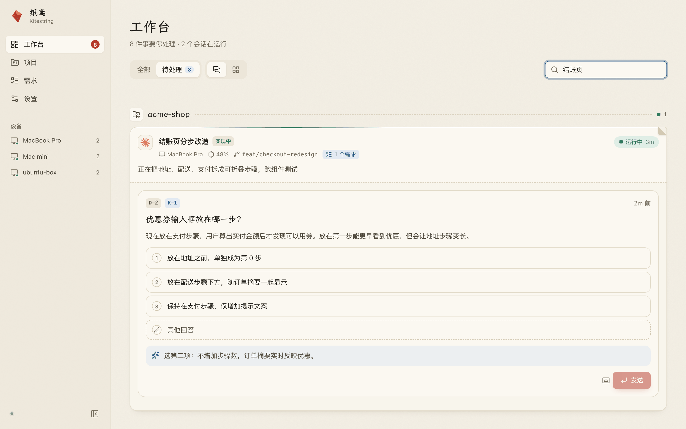
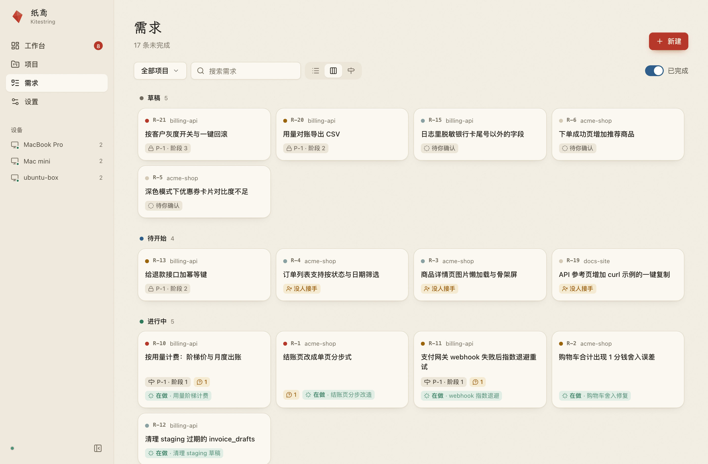
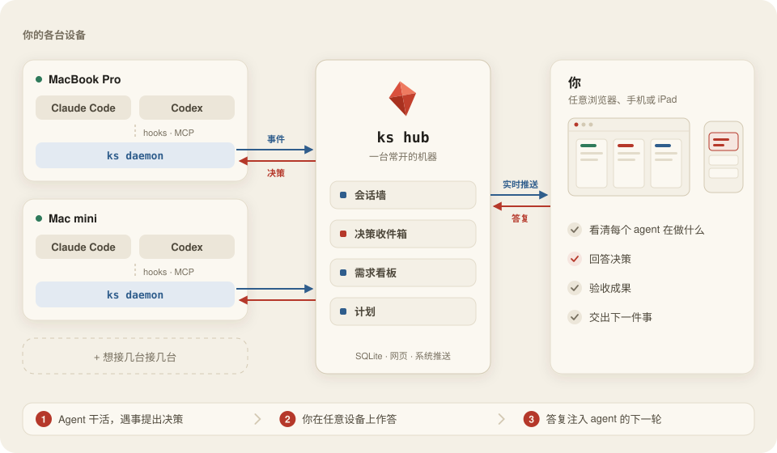

<p align="center">
  
</p>

<h1 align="center">纸鸢 · Kitestring</h1>

<p align="center">
  <strong>风筝飞得再远，线在你手里。</strong><br>
  一块看板管住你所有设备上的 Claude Code 与 Codex 会话：看清每个 agent 在做什么，回答它在等的事，交给它下一件事——在电脑前或手机上都行。
</p>

<p align="center">
  <a href="docs/install.zh-CN.md">安装</a> ·
  <a href="docs/how-it-works.zh-CN.md">工作原理</a> ·
  <a href="README.md">English</a>
</p>

<p align="center">
  <a href="https://github.com/NekroAI/kitestring/actions/workflows/ci.yml"></a>
  <a href="https://github.com/NekroAI/kitestring/releases/latest"></a>
  
  <a href="LICENSE"></a>
</p>

<picture>
  <source media="(prefers-color-scheme: dark)" srcset="docs/assets/screenshot-sessions-dark.png">
  
</picture>

## 它能做什么

- **一眼看清所有会话**：所有设备上的会话按项目归在一起——运行中、等你处理、待命中还是已完成，以及此刻在做什么。
- **在哪都能答复**：agent 需要你拍板时，手机收到推送；点一个选项，答复就进入那个 agent 的下一轮。
- **事情都记在一处**：agent 边做边记下需求；你确认、交给会话、对着截图验收。

<table>
  <tr>
    <td width="50%">
      <picture>
        <source media="(prefers-color-scheme: dark)" srcset="docs/assets/screenshot-decision-dark.png">
        
      </picture>
      <p align="center"><sub>决策带选项和 agent 的推荐</sub></p>
    </td>
    <td width="50%">
      <picture>
        <source media="(prefers-color-scheme: dark)" srcset="docs/assets/screenshot-board-dark.png">
        
      </picture>
      <p align="center"><sub>需求从草稿走到完成，附证据供验收</sub></p>
    </td>
  </tr>
</table>

## 工作原理

<picture>
  <source media="(prefers-color-scheme: dark)" srcset="docs/assets/architecture-dark.zh-CN.svg">
  
</picture>

每台设备上的小 daemon 通过官方的 hooks 与 MCP 感知你的 agent，汇报给一台常开机器上的 Hub；你在任意浏览器里用 Hub 的网页看板。细节见[工作原理](docs/how-it-works.zh-CN.md)。

## 上手

**1. 安装 `ks`**：Hub 和每台写代码的设备都装（macOS 或 Linux）：

```bash
curl -fsSL https://raw.githubusercontent.com/NekroAI/kitestring/main/scripts/install.sh | sh
```

**2. 启动 Hub**：在一台常开的机器上运行，然后打开 `http://<hub>:7310`：

```bash
ks hub passwd && ks install --hub --claude=false --codex=false --daemon=false
```

**3. 接入每台设备**：token 在网页「设置 → 设备」里新增：

```bash
ks login --hub http://<hub>:7310 --token kst_xxx && ks install
```

打开 Claude Code 或 Codex，会话就会出现在看板上。升级、Codex 设置与从源码构建见[安装说明](docs/install.zh-CN.md)。

## 不碰你的订阅

Kitestring 只使用 Claude Code / Codex 官方文档化的扩展点：不碰登录凭证、不代理模型流量、不消耗订阅额度，也不会自己驱动 agent。[详细说明](docs/how-it-works.zh-CN.md#账号安全边界)。

## 参与贡献

欢迎 issue 与 PR，见 [CONTRIBUTING.md](CONTRIBUTING.md)；安全问题请按 [SECURITY.md](SECURITY.md) 私下报告。

## 许可证

[AGPL-3.0-or-later](LICENSE)
