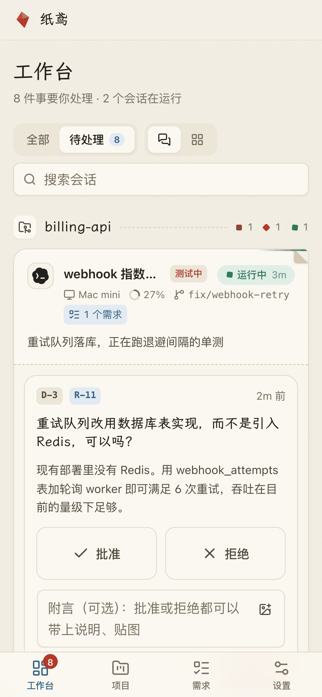

# How Kitestring works

English · [中文](how-it-works.zh-CN.md)

<picture>
  <source media="(prefers-color-scheme: dark)" srcset="assets/architecture-dark.svg">
  
</picture>

## One binary, four roles

Everything is the same `ks` binary; the subcommand decides what it does.

| Command | Runs on | Does |
|---|---|---|
| `ks hub` | one always-on machine | receives events, derives each session's state, stores everything in SQLite, serves the web UI and API, sends notifications, writes summaries |
| `ks daemon` | every development machine | collects local hook events, buffers and replays them while offline, reads git state, caches decisions waiting to be injected |
| `ks hook <claude\|codex> <event>` | called by the agent | thin client to the daemon over a unix socket |
| `ks mcp` | started by the agent | the requirement and decision tools agents call |

The daemon connects **out** to the Hub over a WebSocket, so the Hub never needs to reach your machines — laptops behind NAT, on the road or asleep just reconnect and catch up.

## Where session state comes from

Session state is collected passively; agents don't have to report it.

- **Hooks.** `ks install` registers `ks hook` for Claude Code and Codex lifecycle events (session start and end, prompts, tool calls, permission requests, stop). Each hook forwards the event to the local daemon and returns immediately.
- **Session files.** The daemon reads the agents' local session files (read-only) for context usage and the latest activity.
- **Git.** For each session's working directory, the daemon reports the branch, worktree and number of dirty files. Sessions are grouped into projects by git remote, or by machine and path when there is no remote.

From these events the Hub derives the state you see on the board: running, waiting on you (a permission prompt or a question), standing by, finished, or lost.

**Hooks never get in your way.** `ks hook` has a 1.5-second hard timeout and lets the agent continue on any error — even when the daemon isn't running. It never exits with code 2, which agents would treat as "block".

## How decisions get back to the agent

1. An agent hits something you should decide and calls `decision_raise` with the options and its recommendation.
2. The decision shows up in your inbox, with a push notification to your phone or browser.
3. You answer on the board. The Hub routes the answer to the one session that asked and sends it to that machine's daemon.
4. The next time you send that session a message, its prompt hook injects the answer into the agent's context (`additionalContext`). If the session has ended, the answer is delivered when it resumes.

Requirements work the same way: agents create and update them through MCP; you confirm drafts, hand them to a session, review and accept.

## Waiting for you (`ks wait`)

When an agent finishes a piece of work and needs your review or answer to continue, it can run `ks wait`. As soon as you answer, accept, send back, comment or hand it a new requirement in Kitestring, it wakes up with your input and carries on — no need to go back to the terminal. It's only for waiting on a person, never for timers or automatic continuation.

| | Claude Code | Codex |
|---|---|---|
| How it runs | background task: the turn ends normally, and Claude Code wakes the session when `ks wait` exits | foreground command: Codex can't wake on background exit, so the turn stays open until the command ends |
| Longest wait | 1 hour by default, adjustable with `--timeout`, up to 12 hours | 30 minutes, which is also the default |
| Usage cost | none while waiting | Codex polls the command output, costing a little each time (mostly cache reads), hence the 30-minute cap |
| On timeout | ends quietly; continue in the conversation when you're back | tells the agent to wrap up — report progress and what it's waiting for, then end the turn; later answers arrive in the next conversation |

Waiting sessions show as "standing by" on the board, with how long they have waited and until when.

## Agent tools

`ks mcp` is a local stdio MCP server that `ks install` registers for Claude Code and Codex. It finds out which session called it from its parent process, so agents don't pass session IDs.

| Tool | Purpose |
|---|---|
| `req_list` `req_get` | see the project's requirements |
| `req_create` | record a new requirement (as a draft until you confirm it) |
| `session_link_req` | mark that this session is working on a requirement |
| `req_update_status` | move a requirement along, e.g. to review |
| `evidence_attach` | attach test results, commits, screenshots or recordings for review |
| `decision_raise` | ask you to decide, with options, a recommendation and option images |
| `plan_create` `plan_get` `stage_submit` | split a large goal into stages, follow it, submit a finished stage |

The same operations are available on the command line (`ks req`, `ks plan`, `ks decision`, `ks wait`; see `ks --help`), which is handy when an agent's MCP connection is older than the installed `ks`.

## Account safety

Kitestring only uses extension points that Claude Code and Codex document officially — hooks, `additionalContext`, MCP and read-only access to local session files — and never modifies agent binaries.

- It never reads, stores or forwards credentials from `~/.claude`, `~/.codex` or the keychain.
- It doesn't proxy model traffic, and nothing it does consumes your Claude or ChatGPT subscription. AI summaries are optional and call only an OpenAI-compatible endpoint you configure separately.
- It doesn't drive agents remotely: there is no sending prompts from the web, no `--resume` automation, no tmux keystrokes and no scheduled or chained runs. Agents act only in turns you started.

The reasoning is recorded in D13 and D14 of [decisions.md](decisions.md).

## Data and security

- All local data lives in `~/.kitestring` (override with `KS_HOME`): the device token, the daemon socket and offline queue, logs and, on the Hub, the SQLite database and uploaded files.
- Each machine has its own device token, which you can revoke from **Settings → Devices**.
- The web UI uses a password (bcrypt, rate-limited sign-in) or passkeys, with an HttpOnly session cookie. If you expose the Hub to the internet, put it behind HTTPS.

## Further reading

Design documents are written in Chinese.

| Document | Contents |
|---|---|
| [requirements.md](requirements.md) | MVP requirements: positioning, architecture, views, data model, hook feasibility |
| [decisions.md](decisions.md) | Decision log and open questions |
| [hook-matrix.md](hook-matrix.md) | Tested Claude Code / Codex hook capabilities and state derivation rules |
| [landscape.md](landscape.md) | Survey of similar open-source projects |
| [naming.md](naming.md) | How the name was chosen |
